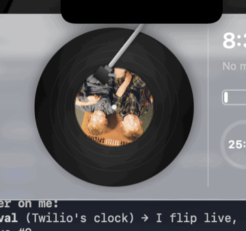

# HaloNotch — the record-player notch

A native SwiftUI menu-bar app that turns your MacBook's **notch into a full
Dynamic Island** — and turns Now Playing into a tiny **turntable** you can tap to
swap between **vinyl · cassette · CD**. Hover the notch to drop a glass tray with
Now Playing, battery, clock/calendar, a Pomodoro timer, and a **camera mirror**
(the FaceTime camera sits right behind the notch). On non-notch Macs it's a
floating top-center pill.

<p align="center">
  
</p>

> **Status — portfolio / build-in-public project.** A personal learning build,
> shared for fun — not a notarized, actively-maintained product. It leans on
> private/undocumented macOS surfaces (other apps' now-playing, macOS 26 Liquid
> Glass) that Apple can change, so expect occasional breakage on OS updates. PRs
> welcome; no support promised.

Researched against the leading apps in this space — NotchNook,
[Boring Notch](https://github.com/TheBoredTeam/boring.notch) (the open-source
reference), Alcove, and Notchy.

## What it does

- **Three states like iOS:** idle (black notch) → compact "live activity" flanks
  (album art + visualizer / timer) → expanded glass tray on hover.
- **Now Playing as a record player** — the album art plays on a spinning record
  with a tonearm; **tap it to cycle skins: vinyl → cassette → CD.** Transport
  controls + a layered backend (see below) so it works out of the box. The record
  spins only while audio plays and eases to a stop on pause.
- **Camera mirror** — the FaceTime camera is physically behind the notch, so a
  button flips the tray into a live mirrored camera view. The capture session
  runs only while the mirror is open (the green privacy light is never on in the
  background).
- **Battery & charging** — fill + percentage + time-to-full/empty, instant
  updates via IOKit power-source notifications.
- **Clock & calendar** — live time/date and your next EventKit events.
- **Timer / Pomodoro** — quick-pick lengths; runs as a compact live activity in
  the closed notch.
- **Apple glass that matches your system** — the tray uses the real macOS 26
  **Liquid Glass** material (`.glassEffect`), falling back to `NSVisualEffectView`
  vibrancy on macOS 14–15. The strip hugging the notch stays opaque black so it
  merges with the hardware. Switchable: Glass / Black / Auto.

## Build & run

Requires macOS 14+, Xcode 26, and [XcodeGen](https://github.com/yonaskolb/XcodeGen).

```sh
git clone https://github.com/ethan5thgrade-alt/HaloNotch.git
cd HaloNotch
xcodegen generate          # creates HaloNotch.xcodeproj (git-ignored)
open HaloNotch.xcodeproj    # then ⌘R in Xcode
# …or headless:
xcodebuild -project HaloNotch.xcodeproj -scheme HaloNotch -configuration Debug build
```

The app has no Dock icon — it lives in the menu bar (the rectangle icon). The
notch panel appears on the screen that has a notch (or the main screen).

### Permissions you'll be asked for

- **Automation** (Spotify / Music) — the first time media controls run, for the
  AppleScript now-playing source.
- **Calendar** — the first time the clock module appears, if you use it.
- **Camera** — the first time you open the mirror.

## The Now Playing backend (the interesting part)

macOS gives apps no public API for *other* apps' now-playing info. Two paths,
layered automatically:

1. **AppleScript source** (always on) — drives **Spotify + Apple Music**.
   Public, no entitlements, never breaks. This is why media works immediately.
2. **Universal MediaRemote adapter** (opt-in) — reads **every** app. Since
   macOS 15.4 the private `MediaRemote` framework is entitlement-gated, so the
   app bundle gets `nil`. The
   [`ungive/mediaremote-adapter`](https://github.com/ungive/mediaremote-adapter)
   trick runs the framework through the system `/usr/bin/perl` (which reports a
   `com.apple.*` bundle id and *is* allowed). Install it with:

   ```sh
   ./scripts/install-mediaremote-adapter.sh
   ```

   It installs to `~/Library/Application Support/HaloNotch/` and HaloNotch picks
   it up on next launch. Until then, you still have Spotify/Music via path 1.

The controller merges both sources (prefers whatever is *playing*) and routes
transport controls to whichever backend can drive the active app.

## Architecture

```
Sources/
  App/           HaloNotchApp (@main + AppDelegate), Preferences, NotchState,
                 SettingsView, MenuBarMenu
  Window/        ScreenGeometry (notch detection), NotchPanel (borderless
                 non-activating NSPanel), HoverMonitor (global cursor tracking),
                 NotchWindowController (positioning + open/close state machine)
  Views/         NotchRootView (3-layer morph), NotchShape (notch silhouette),
                 GlassMaterial (Liquid Glass / vibrancy), ExpandedView
  Views/Modules/ NowPlaying/ (model, sources, controller, view, record skins:
                 vinyl/cassette/CD), Battery/, Clock/, Timer/, Mirror/ (camera)
```

- **Window:** a `.borderless`/`.nonactivatingPanel` `NSPanel` at `.statusBar`
  level, pinned top-center, hosting the SwiftUI tree via `NSHostingView`. It's
  click-through (`ignoresMouseEvents`) when closed and only captures clicks
  while expanded.
- **Notch detection:** `NSScreen.safeAreaInsets.top` + `auxiliaryTopLeftArea` /
  `auxiliaryTopRightArea` give the exact notch rect; falls back to a synthesized
  pill on non-notch Macs.
- **Hover:** a global + local `NSEvent` mouse-move monitor (no accessibility
  permission needed) compares the cursor against the notch / panel rects.
- **Animation:** one interruptible `spring` drives a continuous scale/opacity
  morph (no window resizing → no jank).

## Settings

Menu-bar → **HaloNotch Settings…**: launch at login, hover-vs-click, animation
speed, tray material, now-playing source + visualizer, and per-module toggles.

## Notes / honesty

- The AppleScript path and all four modules are fully implemented and working.
- The universal-adapter **read** path is fully wired; the installer script is
  best-effort against a third-party repo whose layout may change. If it fails,
  build the adapter per its README and drop the two files into the Application
  Support folder.
- Adapter **transport control** for non-Spotify/Music apps is best-effort
  (`send togglePlayPause/nextTrack/previousTrack`); Spotify/Music controls always
  go through reliable AppleScript.
